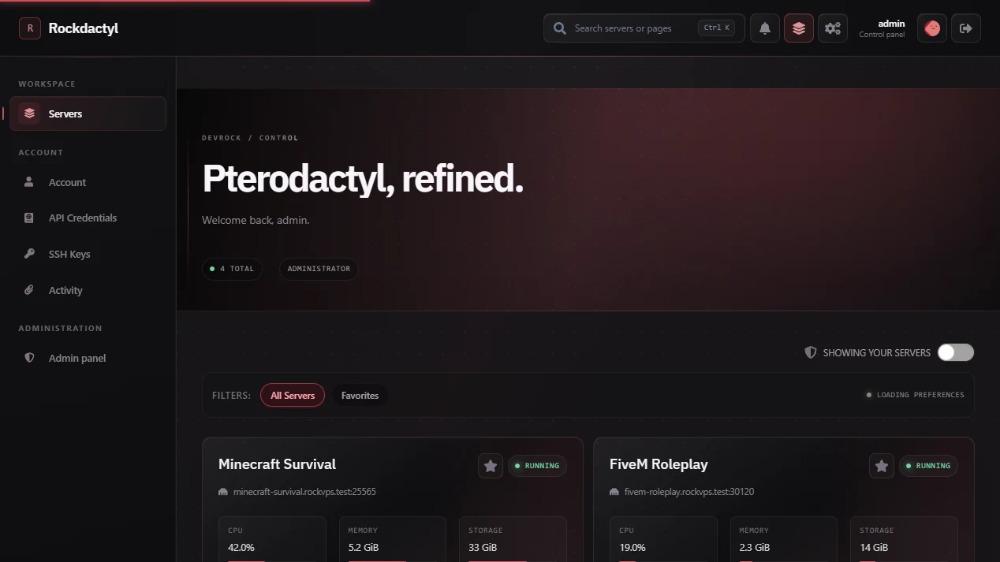

# BHUWAN UI

A Bhuwan RKA branded Pterodactyl panel distribution derived from Rockdactyl, with an original Arix-inspired violet visual system.

**BHUWAN UI** is a customized downstream distribution. Rockdactyl's installer, backup, and container identifiers are intentionally retained for compatibility.

**BHUWAN UI · based on Rockdactyl `v3.0.0` · Pterodactyl Panel `v1.15.1`**

[Website](https://devrock07.github.io/Rockdactyl/) · [Documentation](./docs/README.md) · [Install](./docs/INSTALLATION.md) · [Releases](https://github.com/devrock07/Rockdactyl/releases)

## Build and deployment

> [!CAUTION]
> This is a modified source snapshot, not a published BHUWAN UI release. The inherited `install.sh` still downloads upstream Rockdactyl release artifacts. **Do not run it to install this BHUWAN UI build.** A BHUWAN-specific signed release package and installer must be produced before one-command deployment.

Build requirements: PHP 8.2/8.3, Node.js 22+, and Yarn Classic 1.x. See [source build notes](./docs/development/BUILDING.md) and [BHUWAN UI change log](./BHUWAN-UI-CHANGELOG.md).

<strong>What Rockdactyl includes</strong>

BHUWAN UI keeps the underlying client, server, login, status, and administration workflows intact while applying its own branded visual layer and configuration defaults. It is a panel distribution—not a CSS-only runtime plugin.

This source snapshot is based on Rockdactyl `v3.0.0`, which supports [Pterodactyl Panel `v1.15.1`](https://github.com/pterodactyl/panel/releases/tag/v1.15.1).

| Area | Included |
| --- | --- |
| Visual system | Crimson Red and Midnight Blue across client and admin surfaces |
| Theme Studio | Identity, media, glass, radius, motion, favicons, and console appearance |
| Panel controls | Search, command palette, favorites, groups, quick actions, and mobile navigation |
| Operations | Resource history, persistent notifications, announcements, and public status |
| Delivery | Verified releases, rollback snapshots, recovery guards, and upstream automation |

<strong>Compatibility</strong>

| Component | Supported |
| --- | --- |
| Rockdactyl | `3.0.0` |
| Pterodactyl Panel | `1.15.1` |
| PHP | `8.2` and `8.3` |
| Source builds | Node.js `22+` and Yarn Classic `1.x` |
| Containers | `linux/amd64` and `linux/arm64` |

Upgrade themed installations through a compatible Rockdactyl release. Do not run the official Pterodactyl updater directly over theme files.

<strong>Documentation and project guides</strong>

- [Documentation index](./docs/README.md)
- [Configuration](./docs/CONFIGURATION.md)
- [Operator recipes](./docs/RECIPES.md)
- [Upgrading and recovery](./docs/UPGRADING.md)
- [Troubleshooting](./docs/TROUBLESHOOTING.md)
- [Architecture](./docs/ARCHITECTURE.md)
- [Building from source](./docs/development/BUILDING.md)
- [Contributing](./.github/CONTRIBUTING.md)
- [Roadmap](./docs/project/ROADMAP.md)
- [Changelog](./CHANGELOG.md)

The documentation website source lives in [`website/`](./website) and uses only real screenshots captured from the running panel.

<strong>Support, security, and licensing</strong>

Use [GitHub Issues](https://github.com/devrock07/Rockdactyl/issues) for reproducible bugs, [GitHub Discussions](https://github.com/devrock07/Rockdactyl/discussions) for usage questions, and the [support guide](./.github/SUPPORT.md) to choose the right channel. Report vulnerabilities through the [security policy](./SECURITY.md), never a public issue.

Rockdactyl is a derivative Pterodactyl panel distribution containing NookTheme-derived work and adapted third-party interface components. It is not affiliated with Pterodactyl, Nookure, or React Bits.

- BHUWAN UI modifications in this distribution remain under [GNU GPLv3](./LICENSE), subject to upstream and third-party terms.
- Pterodactyl code retains its [MIT license](./PTERODACTYL_LICENSE.md).
- Component licenses and attribution are in the [third-party notices](./THIRD_PARTY_NOTICES.md).

BHUWAN UI branding: Bhuwan RKA. Copyright and attribution notices for Rockdactyl, NookTheme, Pterodactyl, and third-party components remain with their respective owners.

